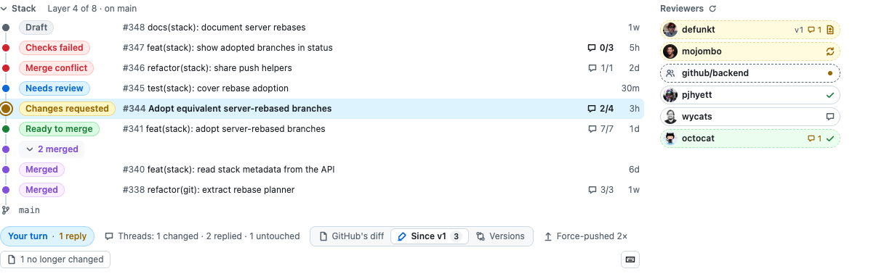
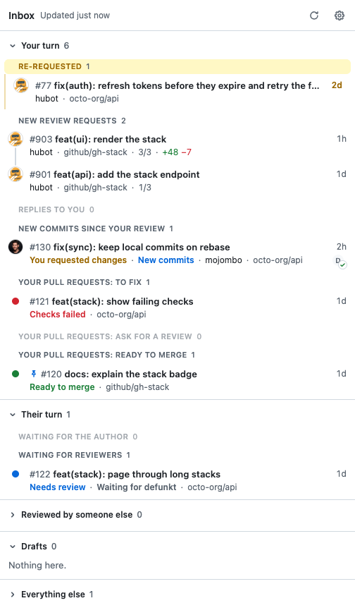
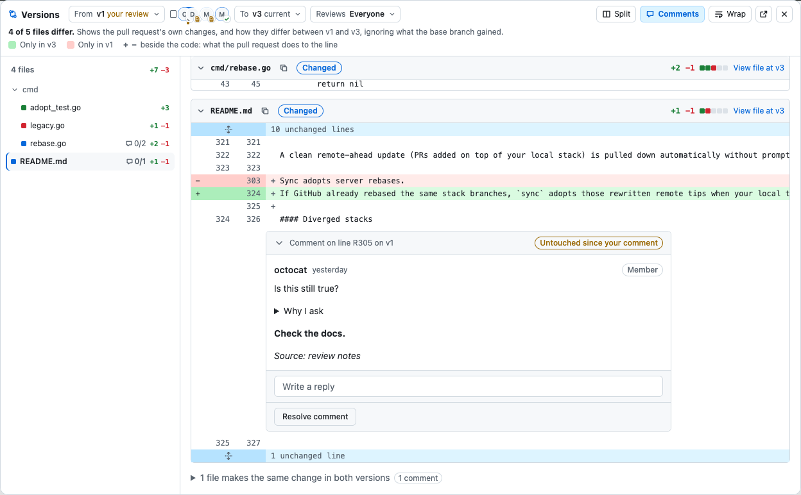
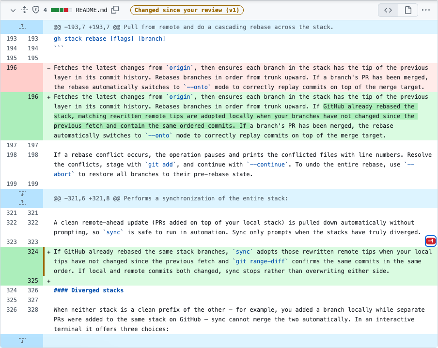
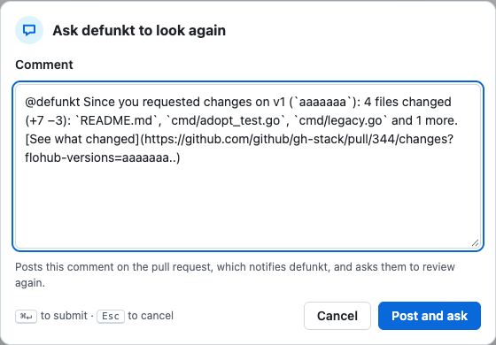
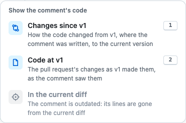

<p align="center">
  
</p>

<h1 align="center">FloHub</h1>

<p align="center">
  <b>A Graphite-style overview on every GitHub pull request.</b><br>
  The stack, every reviewer's verdict, whose turn it is, and a diff between any two versions, even after a rebase.<br>
  For Chrome, Firefox and Safari.
</p>

> [!WARNING]
> **Pure AI slop.** Every line of FloHub, this README included, was written by an AI coding agent (Claude Code), and no human has reviewed it line by line. It may break whenever GitHub changes its pages. Use it at your own risk.

<picture>
  <source media="(prefers-color-scheme: dark)" srcset="docs/screenshots/bar-dark.png">
  
</picture>

## What it does

**The stack and its reviewers.** Every layer of the stack with its status, from *Needs review* to *Ready to merge*, and every reviewer with their verdict: approved, changes requested, asked again. Re-request, poke or dismiss a review with one click. The toolbar says whose turn it is ("Your turn · 1 reply") and whether the open threads were addressed.

**An inbox for your reviews.** The toolbar button lists what waits for you, sorted by whose turn it is, each under a heading that says why. Reviews you're asked for again come first: their author applied your review and waits on a quick second look. A review request someone else already answered moves out of your way, and every other open pull request is one click away. Pin a pull request to the top, snooze it until something happens on it, or switch between a work and a personal profile.

<p align="center"><picture>
  <source media="(prefers-color-scheme: dark)" srcset="docs/screenshots/inbox-dark.png">
  
</picture></p>

**Every version of a pull request.** Compare any two versions, even across force pushes and rebases: FloHub diffs what the pull request itself changes, so nothing the base branch gained shows up. A timeline marks who reviewed which version, and each comment says whether its code changed since.

<picture>
  <source media="(prefers-color-scheme: dark)" srcset="docs/screenshots/versions-dark.png">
  
</picture>

**What changed since your review**, highlighted in GitHub's own diff, so a second look takes a minute.

<p align="center"></p>

<table>
<tr>
<td width="50%" valign="top">

**Stale approvals.** A reviewer whose approval is a few versions old shows which one. Ask them to look again with a comment that lists what changed since.



</td>
<td width="50%" valign="top">

**From a comment to its code.** A comment's file link opens the change since it was written, the code as it saw it, or the current diff.



</td>
</tr>
</table>

There's more: Graphite's keyboard shortcuts, Viewed checkboxes and line counts in the file tree, a floating pill when you scroll away, the review texts in one list, and a status favicon. [Everything FloHub does](docs/features.md) has the details.

## Install

1. Build it and load it into Chrome:

   ```bash
   bun install && bun run build
   ```

   Open `chrome://extensions`, turn on **Developer mode**, click **Load unpacked** and pick `dist/`. After a rebuild, click the card's reload icon.
2. Click FloHub's toolbar icon and paste a GitHub token. [This link](https://github.com/settings/tokens/new?description=FloHub&scopes=repo,read:org) creates a classic one with the scopes it needs: `repo` to read pull requests and re-request reviews, `read:org` to show requested teams.

<details>
<summary>Firefox, Safari and fine-grained tokens</summary>

For Firefox (128 or later), run `bun run build:firefox` instead, open `about:debugging#/runtime/this-firefox`, click **Load Temporary Add-on…** and pick `dist-firefox/manifest.json`. Firefox drops temporary add-ons on restart. To keep it installed, download the signed `.xpi` from the latest [release](../../releases) and open it in Firefox. If the options page says FloHub can't read GitHub, click **Allow access to GitHub**, or allow it under the add-on's **Permissions** in `about:addons`.

For Safari on macOS, download `flohub-safari-<version>.zip` from the latest [release](../../releases), unzip it, move `FloHub.app` to Applications and run `xattr -dr com.apple.quarantine /Applications/FloHub.app` once, since the app isn't signed with an Apple developer account. To build it yourself instead, run `bun run install:safari` (needs Xcode): it builds the app, copies it to `~/Applications` and opens it. Open the app once, then in Safari turn on **Show features for web developers** under Settings → Advanced, choose **Develop → Allow Unsigned Extensions**, and enable FloHub under Settings → Extensions with `github.com` and `api.github.com` allowed. Safari turns **Allow Unsigned Extensions** off on every restart, so tick it again after relaunching. Safari doesn't update FloHub on its own: install a newer release, or run `bun run install:safari` again.

A fine-grained token works too. Choose the organization as resource owner and grant Pull requests: Read and write, Checks: Read, Commit statuses: Read, and optionally Members: Read. The organization may need to approve it. If the token can't read a field, the overview still renders and a notice names what's missing.

</details>

## Shortcuts

On every pull request tab, never while you type. The keyboard button at the end of the bar lists them too.

| Keys | Action |
|---|---|
| <kbd>⌘</kbd><kbd>⇧</kbd><kbd>↑</kbd> / <kbd>↓</kbd> | The pull request above / below in the stack (<kbd>Ctrl</kbd> outside macOS) |
| <kbd>R</kbd> <kbd>Y</kbd> | Approve |
| <kbd>R</kbd> <kbd>A</kbd> | Approve with a comment |
| <kbd>R</kbd> <kbd>N</kbd> | Request changes |
| <kbd>C</kbd> <kbd>C</kbd> | Copy `gh pr checkout <number>` |
| <kbd>C</kbd> <kbd>G</kbd> | Copy the pull request's link |
| <kbd>1</kbd> <kbd>2</kbd> <kbd>3</kbd> | Pick a choice in a comment's menu |
| <kbd>Esc</kbd> | Close a menu, a dialog or the versions view |

A review shortcut submits your pending review with its draft comments, as GitHub's "Submit review" does. In the inbox, <kbd>j</kbd> <kbd>k</kbd> move, <kbd>Enter</kbd> opens, <kbd>p</kbd> pins and <kbd>s</kbd> snoozes.

## Develop

`bun run check` runs the typecheck, the linters, knip and the unit tests; `bun run e2e` drives a real pull request in Chromium against a mocked API; `bun run storybook` shows every view in light and dark. [Developing FloHub](docs/development.md) covers the commands, the release and the layout of the code.
